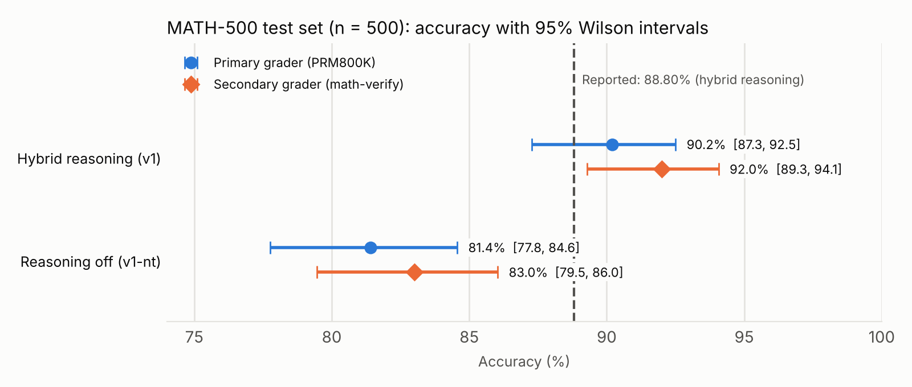
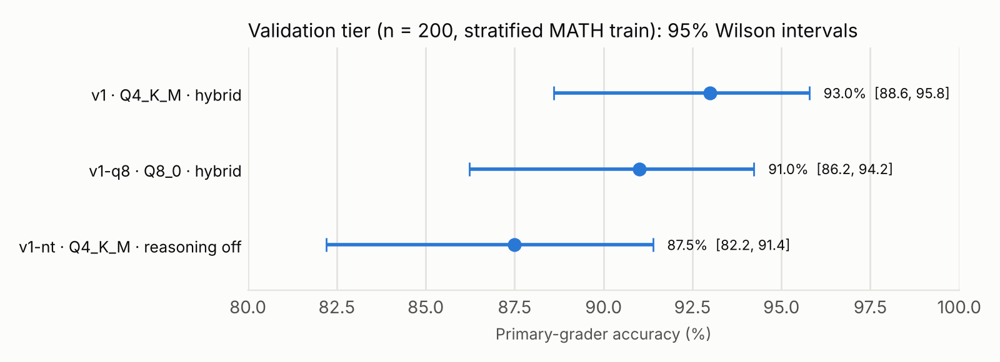
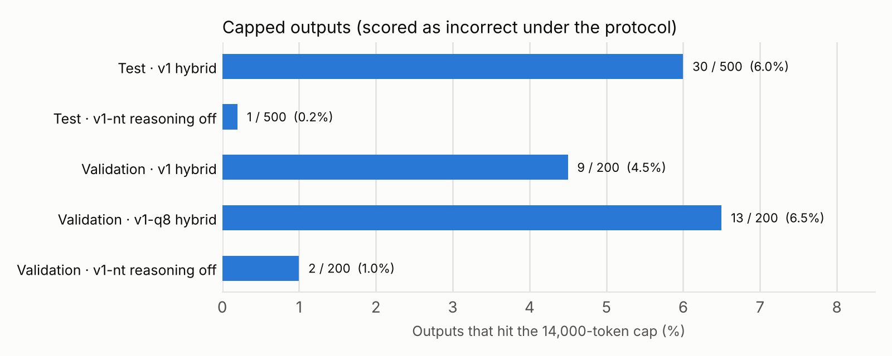

# Reproducing Qwen3-8B on MATH-500 on a laptop: 90.2%, consistent with the reported 88.8%

*October 2026 · kaariger*

## TL;DR

- We independently re-measured **Qwen3-8B on MATH-500** with a fully local, pinned setup on an Apple Silicon laptop. We used Qwen's official 4-bit GGUF, run through llama.cpp.
- **Headline: 90.2% (451/500), 95% interval 87.3–92.5%.** MathGPT.ai's reported **88.80%** lies inside that interval. By the rule we declared before running the test set, the reproduction is **consistent**.
- **Two choices move the number by about 2 points:**
  - **Grader.** A second, independent grader scores the same outputs at 92.0%.
  - **Output cap.** 6% of answers hit the 14,000-token cap and were scored as wrong.
- **Turning reasoning off costs 8.8 points** (81.4%).

## Why we did this

In June 2025, MathGPT.ai published a large-scale evaluation of open models on mathematical reasoning ([Khanna et al., 2025](https://www.mathgpt.ai/blog/2025/06/03/are-the-best-open-source-models-qwen-phi-nvidia-deepseek-robust-mathematical-reasoners-insights-from-large-scale-evaluations)). It reported **88.80% for Qwen3-8B on MATH-500**, using hybrid reasoning generation. That post's main theme is **robustness**: on a 90-problem subset, Qwen3-8B fell from 87.78% on the original problems to 74.44% on one set of perturbed variants.

Before studying robustness, or trying to improve it with fine-tuning, we wanted a baseline we could trust. That meant three things:
- an independent re-measurement of the headline number;
- on hardware anyone can own;
- with every setting pinned and every step auditable.

## Setup

| | |
|---|---|
| Hardware | Apple M1 Pro laptop, 32 GB unified memory. Local only; no hosted inference. |
| Runtime | llama.cpp release `b10412`, pinned by commit and archive hash |
| Model | Qwen's official `Qwen3-8B-Q4_K_M.gguf`, pinned by repository revision and file SHA-256. A Q8_0 probe was also run. |
| Context / output cap | 16,384 / **14,000** tokens. Context shift is off, so the cap is terminal. |
| Sampling | Temperature 0.6, top-p 0.95, top-k 20, min-p 0. One sample per problem, seed 0. |
| Reasoning | Hybrid: the chat template's default. In practice the model produced a thinking block on **all 500** test problems. |
| Prompt | The problem, then `Please reason step by step, and put your final answer within \boxed{}.` No system message, zero-shot. |
| Extraction | The last `\boxed{…}` in the output |
| Graders | **Primary:** the PRM800K grader, pinned commit. **Secondary:** `math-verify` 0.8.0. |

## How we kept it honest

- **Three tiers, frozen in advance.**
  - a 16-problem smoke tier;
  - a 200-problem **validation** tier drawn from MATH *train*, stratified by subject and difficulty;
  - the 500-problem **test** tier.

  Every tier's item IDs were frozen before first use.
- **Tuning happened on validation only.** The protocol was frozen by file hash after the validation runs, **before** the test set was touched. No setting changed afterwards.
- **The reading rule came first.** It was written down before the test run: *consistent* if 88.80% falls inside the headline's 95% Wilson interval.
- **One test pass per configuration.** No reruns, and no picking the better run.
- **Two independent graders** score every answer. The primary grader drives the headline; the secondary measures how sensitive the result is to the grader.
- **Independent tests.** The harness was checked by a test suite written separately from the implementation. It included **85 hidden tests**, registered by hash before implementation began and revealed only at review. All 81 required visible tests and all 81 required hidden tests pass on the final code.
- **Deterministic re-scoring.** Re-running extraction and both graders on the stored outputs reproduced **2,000 / 2,000** verdicts.
- **Provenance.** The runtime, model file, protocol and dataset manifest are all pinned by SHA-256 and recorded with every run.

## Results

### Test set (MATH-500, n = 500)

| Configuration | Primary grader | 95% interval | Secondary grader | Capped outputs | Thinking |
|---|---:|---:|---:|---:|---:|
| **Hybrid reasoning (v1), the headline** | **90.2%** | 87.3–92.5% | 92.0% | 30 | 100% |
| Reasoning off (v1-nt), the sensitivity probe | 81.4% | 77.8–84.6% | 83.0% | 1 | 0% |

- **The reading: consistent.** 88.80% lies inside 87.3–92.5%, and our headline is 1.4 points above it. If the reported figure came from a single 500-problem pass, it would carry similar uncertainty: roughly 85.7–91.3%.
- **Reasoning matters.** On the same 500 problems, forcing reasoning off costs **8.8 points** (paired bootstrap 95% interval: −11.8 to −5.8).
- **Throughput.** The headline run took **32 h 36 m** on the laptop, at about 21–22 tokens per second. With reasoning off, outputs are much shorter, and the run took 5 h 47 m.

### Validation probes (n = 200)

Before freezing the protocol, we ran two probes on the validation tier:
- **Q8_0 quantization:** 91.0% vs 93.0% for Q4_K_M. The 2-point gap is about the size of its four extra capped outputs.
- **Reasoning off:** 87.5%, 5.5 points below.

Neither probe changed the protocol: v1 was frozen as originally specified.

## Two sensitivities worth knowing

**1. The grader.**
- In validation, the two graders' accuracies differed by at most 0.5 points, with disagreements going both ways.
- On the test set, **all 9 headline disagreements went one way**: the secondary grader accepted answers the primary rejected.
- Under the secondary grader, the headline is 92.0% (89.3–94.1%), and that interval *excludes* 88.80%.

The reading uses the grader declared in advance, so it stands. But the choice of grader alone moves the result by about 2 points. Reports of MATH-500 accuracy should say which grader they used.

**2. The output cap.**

- **What happened:** 30 of the 500 headline answers (6.0%) hit the 14,000-token cap. The protocol scores them as wrong.
- **Why they were capped:** a structural review found that 29 were still reasoning when they were cut off, and one was stuck in a repetition loop.
- **Two of them already contained a complete boxed answer** before the cut-off. Counting those would give 90.6%.
- **The bounds:** the headline lies between **90.2%** (as scored) and **96.2%** (if every capped answer had been right).

Output length, and with it the truncation rate, can shift whenever the model, the quantization or the fine-tuning changes. Any before-and-after comparison should therefore declare a cap-sensitivity reading in advance.

## Caveats

- **A single seed.** The intervals cover sampling of problems, not run-to-run variation at temperature 0.6. Additional seeds are deferred.
- **A reconstructed protocol.** The original post doesn't state its sampling settings, output budget or grader. Ours are documented choices, and they may differ.
- **Local quantized inference.** The headline uses 4-bit weights. The Q8_0 probe suggests the effect is small but not zero.
- **Laptop conditions.** The machine slept twice during the headline run. Generation paused and resumed, with no failed or repeated work.

## Next steps

We plan to work in this order. Every step keeps the same discipline: frozen protocols, readings declared in advance, and like-for-like comparisons.

1. **Tighten the baseline (cheap, local).**
   - **Run-to-run variation:** repeat the headline with more seeds, so the intervals cover sampling noise as well as the choice of problems.
   - **Cap sensitivity:** re-generate the 30 capped problems with a larger output budget, reported as a secondary reading declared in advance.
   - **Grader disagreements:** classify the 21 cases where the graders disagreed, to see whether the primary grader rejects equivalent forms of the same answer.
   - **Reference-harness check:** run the same protocol through an established public evaluation harness, and explain any differences.
2. **Robustness, the original study's main question.** Measure how accuracy changes on perturbed variants of problems (GSM-Symbolic-style templates and variant sets), alongside the original problems.
3. **More models through the same pipeline.**
   - **Candidates:** Qwen3.5-9B (the same family's successor), a model from a different family (Gemma 4 E4B), and selected models from the original study.
   - **Same treatment for each:** the same frozen protocol, both graders and the same sensitivity readings.
4. **Choose the most promising model to fine-tune,** using criteria declared in advance:
   - accuracy;
   - how much accuracy drops on variants;
   - inference cost per problem.
5. **Fine-tune it, and compare like for like.**
   - **Data:** math reasoning data, checked against MATH-500 and every other evaluation set, with any overlap removed before training. This is a hard gate.
   - **Method:** parameter-efficient fine-tuning (LoRA) on cloud GPUs, with checkpoint and resume.
   - **Evaluation:** the base and fine-tuned models under the same frozen protocol, runtime and quantization, as a paired comparison registered before the test set is used. **Robustness on variants is the primary target**, so that any gain isn't just benchmark overfitting.
6. **Faster evaluation.** Split runs across cloud GPUs to bring 30-hour runs down to hours. First, a calibration run must confirm that the cloud setup agrees with the laptop within a tolerance declared in advance.

If you maintain variant or tutoring-style math datasets suitable for robustness evaluation or fine-tuning, we'd be glad to hear from you.

## Reproducing this

Everything needed to rerun the evaluation is in this repository:
- the pinned runtime and model details: [decision 0001](../../decisions/0001-local-qwen-runtime.md);
- the frozen protocol files: [`configs/protocols/`](../../../configs/protocols/), and the [protocol decisions](../../math500-protocol-proposal.md);
- the dataset manifest: [`configs/datasets/`](../../../configs/datasets/);
- the [evaluation methodology](../../evaluation-methodology.md);
- the harness and its test suites.

The figures here are regenerated by [`make_figures.py`](make_figures.py) from the aggregate counts above. Per-problem raw outputs are retained but not published.

## References

- Khanna, Rastogi, Kumar, Relan, Tran (MathGPT.ai), [*Are the best Open Source models (Qwen, Phi, Nvidia, DeepSeek) robust mathematical reasoners: Insights from Large-Scale Evaluations*](https://www.mathgpt.ai/blog/2025/06/03/are-the-best-open-source-models-qwen-phi-nvidia-deepseek-robust-mathematical-reasoners-insights-from-large-scale-evaluations), June 2025.
- Hendrycks et al., *Measuring Mathematical Problem Solving With the MATH Dataset*, 2021 ([data](https://github.com/hendrycks/math)).
- Lightman et al., *Let's Verify Step by Step* (PRM800K and the MATH-500 split), 2023 ([repository](https://github.com/openai/prm800k)).
- [Math-Verify](https://github.com/huggingface/Math-Verify), a mathematical answer-equivalence checker.
